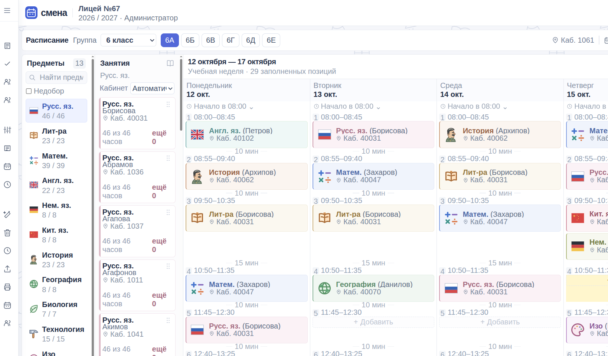

# Смена

[](screenshot.png)

Школьное расписание. Требования и порядок реализации: [technical-spec.md](technical-spec.md).

## Текущее состояние

**PostgreSQL 18 — основное хранилище.** Доступен перенос школьных данных через архив `.smena.gz` в «Общие настройки». Перед заменой архив проверяется и показывается предпросмотр; восстановление требует явного подтверждения и автоматически сохраняет текущие данные. Руководство по эксплуатации и формату архива: [docs/operations.md](docs/operations.md), [docs/postgres-migration.md](docs/postgres-migration.md). Подготовлены самостоятельный Docker Compose и размещение в общем пуле rich по `/smena/`: [деплой и обновление](docs/deployment.md).

**Страница замен: техническая проверка 8.1.5 выполнена, готово к визуальной приёмке.** На копиях текущих 181 324 уроков проверены частичные назначения, ограничения, совместные уроки, ошибки и повторы, две вкладки, отмена и отдельная публикация. Исправлены выбор уроков по списку ID, бессрочный период без явного исходного преподавателя и состояние диалога при неизвестном результате записи. 18 сценариев API, полный набор тестов и сборка прошли. В браузере 20 изменений строки: медиана 111 мс, максимум 122 мс; при CPU-эмуляции ×4 — 159/195 мс. Рабочая база не менялась. [Матрица, снимки и ограничения](docs/teacher-replacements-review.md). **Остаются ваш визуальный просмотр и замер на школьном компьютере**; подэтап целиком ещё не принят.

**Левая панель** заменила меню «Действия»: наведите указатель для раскрытия или закрепите её кнопкой сверху. С неё открываются учебные планы, справочники, календарь, автосоставление, очистка и часы четверти.

**Учебный план назначается одной или нескольким группам.** Создайте план на четверть (например, «Физмат»), заполните предметы и часы, затем отметьте группы. Кнопка «Создать копию» переносит предметы и нормы в новый неназначенный план: его можно немного изменить для других групп. Также можно создать план из заполненного плана группы. Отдельного вида «индивидуальный план» и отдельной страницы больше нет.

**Подгруппам задаётся одна норма:** «Информатика, по подгруппам, 18 часов» означает по 18 часов каждой выбранной подгруппе группы. В строке плана можно выбрать участников отдельно для каждой назначенной группы; без уточнения используются все активные подгруппы из справочника. При отсутствии подгрупп приложение попросит добавить их. Число подгрупп у разных назначенных групп может отличаться. Изменение нормы распространяется на все назначенные группы после сохранения, а расставленные уроки остаются прежними.

Существующие планы представлены в едином списке. При снятии назначения или удалении плана последние часы сохраняются для групп в отдельных именованных копиях, доступных на этой же странице. Четверти создаются и редактируются в «Учебном календаре» вместе с каникулами и учебными днями. В планах остаётся выбор четверти.

Доступен **обмен обычных одиночных уроков** одной группы: перетащите урок на другой в зелёной рамке — они поменяются местами без подтверждения. Красная сплошная рамка означает конфликт; оба назначения проверяются по учителю и кабинету. Время остаётся у ячеек, уроки перемещаются с преподавателями, кабинетами и примечаниями; отмена возвращает оба. Для другой недели задержите урок над её датой в нижней полоске. Обмен подгрупп, совместных уроков и мероприятий пока не поддерживается.

**Пустые ячейки в конце дня:** пока последняя ячейка не заполнена, кнопка «+ Ячейка» недоступна. Корзина справа от времени последней пустой ячейки удаляет её вместе с переменой перед ней. Несколько прежних пустых ячеек можно убрать по одной; «Отменить» возвращает ячейку и её время.

Подэтап **4.2а — ручной контроль одновременной занятости учителей** реализован и готов к визуальному просмотру. Он добавляет красную подсветку конфликтных ячеек, подсказку с занятым учителем, группой и временем, блокировку обычного назначения и отдельный подтверждаемый перенос с атомарным удалением прежнего обычного урока. Общие уроки и мероприятия таким переносом не удаляются. Проверка не запрещает сохранять исторические конфликты, если они не усиливаются. Это не означает, что весь этап 4.2 уже завершён. Приоритеты остальных этапов и их статусы приведены в [таблице порядка работ](technical-spec.md#12-актуальный-приоритет-и-этапы-реализации).

**Левая панель → Время и перемены:** общие начало дня, длительность урока и перемены для всех групп. Отдельных настроек звонков группы нет. «Сохранить настройки» задаёт время новых дней; уже заполненные дни не пересчитываются. Для существующих дней есть «Применить настройки к расписанию» с выбором групп, дат и предварительным просмотром. По умолчанию сохраняются фактическое начало и индивидуальные перемены. Новые пересечения учителей, кабинетов и несовпадающие интервалы общего занятия блокируют применение целиком.

**Сокращённый день:** нажмите «Начало в …» над нужным днём расписания. В диалоге «Начало учебного дня» задайте начало в 24-часовом формате и длительность уроков. Рядом можно включить «Длительность всех перемен, мин», например 5 минут; без галочки используются общие школьные перемены. В «Применить на эту дату» выберите текущую группу (по умолчанию), несколько групп по галочкам или все группы. Начало выше относится только к текущей группе, остальные сохраняют своё фактическое начало дня. Если текущая группа не выбрана, поле начала отключено. Предпросмотр показывает время до/после для каждой группы; группы без учебного дня или ячеек явно пропускаются. Новое пересечение учителя/кабинета или расходящиеся интервалы общего занятия блокируют применение целиком. Изменение сохраняется и отменяется одним действием для всех выбранных групп. Если отмена восстановит старый конфликт, это заранее показано в предпросмотре; такая отмена запрещена существующей проверкой. Другие даты и невыбранные группы не меняются.

**Адреса страниц:** расписание — `/schedule`, справочники — `/catalog`, учебные планы — `/plans`, календарь — `/calendar`, время и перемены — `/bells`. Прямой переход и обновление страницы сохраняют выбранный раздел; корень открывает `/schedule`.

**План группы задаёт только часы:** предмет, вид занятия (обычный или лабораторный), норма для всей группы или одинаковая норма каждой выбранной подгруппе. Преподаватели и кабинеты выбираются в расписании. Изменение плана не переписывает уже поставленные уроки. Четверти переключаются в верхней полоске; прошлые периоды можно заполнять необязательно. Счётчики отражают реально внесённые уроки выбранной четверти; один урок считается одним часом независимо от длительности.

В справочнике учителя отмечаются его предметы и необязательный кабинет по умолчанию. Специальности показаны одним алфавитным списком. При выборе предмета в расписании доступны все подходящие активные преподаватели. Кабинет подставляется от преподавателя, затем от группы; его можно поменять над карточками перед расстановкой или в самом уроке. Замена учителя существующего урока сохраняет его время, кабинет и часы.

Группа содержит основной кабинет и **предпочтительные кабинеты для автосоставления**. Фиксированного количества нет; начальная рекомендация — основной и 2–4 ближайших. Остальные свободные подходящие помещения используются при нехватке. Типы специальных кабинетов задаются у предмета отдельно для обычных и лабораторных занятий. При пустом требовании обычным урокам подходят общие кабинеты, лабораторные наследуют требование обычных. У кабинета задаются тип и необязательная вместимость. После обновления проверьте эти типы перед автосоставлением: существующие кабинеты не переклассифицируются автоматически.

**Левая панель → Автосоставление:** выберите группы, получите предложение, просмотрите новые уроки и нераспределённые часы, затем нажмите «Применить в черновик». Расчёт не сохраняет данные. По умолчанию генератор дополняет свободные места в пределах выбранной четверти, учитывает внесённые часы, каникулы, подгруппы, специальности учителей, занятость учителей и кабинетов по фактическому времени, тип и известную вместимость помещений. При включённом сохранении ручные уроки сохраняются; время ячеек сохраняется в обоих режимах. Генератор ограничивает день группы семью занятыми ячейками: параллельные подгруппы считаются одной, мероприятия тоже занимают ячейку. Уже сохранённые дни с более чем семью уроками не очищаются, их нагрузка не увеличивается. При выборе места учитывается общая нагрузка дня и недели с поправкой на количество доступных учебных ячеек, чтобы избегать перегруженного начала четверти. Это мягкое предпочтение: занятость ресурсов и предпочтения кабинетов могут потребовать отклонений. Флажок «Объединять уроки параллельных классов» включён по умолчанию и разрешает новые общие уроки согласно настройкам предметов. Без него генератор составляет отдельные занятия; уже сохранённые объединения сохраняются при включённом сохранении заполненных уроков. Показывается количество обычных уроков вне предпочтительных кабинетов. Алгоритм не гарантирует оптимального результата; остальные санитарные нормы не автоматизированы. Используются существующие ячейки и календарные данные: их настройку нужно проверить до расчёта. Уже имеющиеся конфликты генератор не исправляет.

Занятость кабинетов проверяется также при ручном добавлении, переносе, изменении кабинета, времени и перемен; сервер повторяет проверку. Новые пересечения запрещены. Старые пересечения можно сохранять без увеличения, чтобы постепенно исправлять расписание. Старый текстовый кабинет без связи со справочником требует выбора записи из справочника для проверки занятости. Автосоставление уже избегает новых конфликтов учителей. Ручная проверка типа и известной вместимости кабинета реализована: учитываются вид занятия, численность подгруппы и сумма участников общего занятия. Неизменённые старые несоответствия можно сохранить, новые и усиленные запрещены. Недоступность учителей и кабинетов учитывается в ручных действиях, автосоставлении и на сервере. Сохранённые пересечения с новым больничным или ремонтом отмечаются в расписании, уроки остаются на своих местах. В выпадающих списках расписания неподходящие по типу или вместимости кабинеты скрыты. При редактировании также скрыты занятые и недоступные на выбранное время варианты. Текущий кабинет остаётся виден, чтобы исправить старое несоответствие.

При ручном добавлении с выбором «Автоматически» и при автосоставлении кабинеты выбираются в одном порядке: кабинет конкретного учителя → основной кабинет группы → отмеченные кабинеты группы → остальные подходящие свободные кабинеты. Классное руководство на выбор помещения не влияет. Основной кабинет группы необязателен. Проверяются тип, известная вместимость, занятость и недоступность; для общего урока учитывается суммарная численность участников. Изменение предпочтений не переносит уже сохранённые уроки.

Справочники групп, подгрупп, учителей, кабинетов и предметов сохраняются в PostgreSQL. Записи можно искать, сортировать по заголовкам, архивировать и восстанавливать. В диалоге «В архив» есть «Удалить»: запись удаляется окончательно только без ссылок из уроков, планов, других справочников и истории. Причина блокировки доступна через i. У архивных записей удаление доступно в «Изменить». Архивирование сохраняет уже назначенные уроки, включая будущие. Переименования сохраняют связи с уроками. При добавлении курсор находится в первом поле, Tab проходит по полям до кнопки «Сохранить». Для предметов доступна кнопка «Подобрать цвет», компактный список и образец; новый предмет автоматически получает наименее используемый оттенок.

Администратор создаётся при первом открытии. Редактор и API доступны только после входа; выход находится внизу левой панели. Расписание автоматически сохраняется. Перед закрытием страницы дождитесь надписи «Сохранено». Отмена последних 30 действий действует до перезагрузки или перехода на другую страницу; применённое автосоставление — одно действие. При потере сети доступен повтор сохранения, при истечении сеанса — повторный вход без потери правок. Конфликт версий требует явной загрузки данных из базы; автоматического объединения и автономного хранилища браузера нет.

**Левая панель → Учебный календарь:** добавьте или измените четверти, настройте общие учебные дни недели и отдельные дни для групп (например, пятидневка у младших и шестидневка у старших), добавьте каникулы, неучебные или дополнительные учебные даты для всей школы либо выбранных групп. Перед применением отображаются затронутые даты и количество снимаемых занятий; снятие требует подтверждения. Изменения формы до применения не сохраняются. У остальных участников общего занятия запись сохраняется. Открытие даты для обучения не восстанавливает снятые уроки автоматически. Автосоставление учитывает новый календарь.

В «Графике групп → Настроить график групп» можно отметить сразу несколько групп и задать им одинаковые учебные дни или вернуть школьный график. Изменения остальных групп сохраняются. Выход с несохранёнными изменениями требует выбора в отдельном диалоге.

Для ввода дат используется русский календарь с понедельника; дату также можно ввести как ДД.ММ.ГГГГ. Год выбирается из компактной сетки с перелистыванием; выбор года сам по себе не меняет дату в поле.

Обычная сетка содержит пять дней; учебная суббота или воскресенье появляются дополнительно. Исключения отдельных групп имеют приоритет над общешкольными; внутри одной области явный учебный период имеет приоритет над каникулами и неучебными днями. Старые отметки каникул перенесены в групповые периоды с сохранением расписания.

При создании новой базы загружается пример: три группы, I четверть с 1 сентября по 30 октября 2026 года и уроки за 5–30 октября. Для действующей базы пример повторно не загружается. Учебный календарь и общие настройки звонков доступны в левой панели; сокращённый день задаётся прямо в расписании. Публикация и публичные страницы запланированы позже. Время параллельных подгрупп пока общее для ячейки.

У учителя можно выбрать **предпочтительные группы**: автосоставление отдаёт ему приоритет при подходящей специальности и свободном времени, иначе выбирает другого. У предметов с объединением одной параллели задаётся **максимум групп в одном совместном уроке** (по умолчанию две). Другой зал с другим учителем может проводить отдельный урок одновременно. Лимит не относится к линейке и классному часу; их можно добавить из левой панели для выбранных групп.

Слева показаны короткие названия предметов из справочника; полные доступны при наведении, поиск работает по обоим. В диалоге «План четверти» выполненная норма зелёная, недобор до 30% включительно жёлтый, больший недобор и превышение красные. Типы кабинетов пока фиксированы. Лабораторный урок занимает один выбранный кабинет на всё время занятия; переход между двумя помещениями пока не моделируется.

Страница **«Выполнение учебных планов»** (`/plan-coverage`, пункт «Выполнение планов» рядом с учебными планами) показывает процент заполнения расписанием по классам и группам за выбранную четверть. Рядом с процентом указаны покрытые часы и норма. В фильтре групп есть поиск `!1` и выбор видимых; значки в строке открывают расписание и диалог «План четверти». Группы без плана отмечены отдельно. Процент учитывает нормы каждого предмета и подгруппы: лишние уроки по одному назначению не закрывают недобор по другому.

## Запуск

Нужны Node.js 24 LTS или совместимая более новая версия и npm. Проверено на Node.js 26.8.2.

Подготовьте отдельную базу PostgreSQL 18 и пользователя, скопируйте `.env.example` в `.env.local` и задайте `SMENA_DATABASE_URL`. Файл `.env.local` исключён из Git; `npm run dev` и `npm start` загружают его автоматически. При старте создаются таблицы и 25 базовых предметов без перезаписи пользовательских данных. Новая PostgreSQL-база не содержит демонстрационных групп, преподавателей, расписания и готового администратора. Перенос существующей SQLite-базы выполняется явно по [инструкции](docs/postgres-migration.md).

```bash
npm ci
npm run dev
```

Открыть <http://127.0.0.1:5173>. Одна команда запускает интерфейс и API. Оба слушают только локальный интерфейс; Vite передаёт `/api` серверу на порту 3001.

Главная страница `/` открывает опубликованное расписание учеников без входа. Для управления нажмите «Администратору» или откройте `/admin`; вход ведёт в защищённый редактор `/schedule`. При первом входе администратора задайте логин и пароль (не менее 8 символов). Готового пароля нет. Пароль хранится в виде хеша, сеанс — в HttpOnly cookie. Изменяющие запросы требуют авторизации и CSRF-токена. Восстановление забытого пароля пока не реализовано.

Запуск собранного приложения:

```bash
npm run build
npm start
```

Открыть <http://127.0.0.1:3001>. Сервер отдаёт и интерфейс из `dist/`, и API. Команда `npm run preview` предназначена только для Vite-просмотра и не заменяет сервер приложения.

Сервер приложения сжимает ответы gzip, если браузер поддерживает его: JSON, код, стили, SVG и TTF-шрифты. Для обычных ответов порог составляет 1 КБ; потоковые файлы сжимаются при передаче. Архивы `.smena.gz` повторно не сжимаются. Для проверки объёма загрузки открывайте собранное приложение на порту 3001: файлы Vite на порту 5173 относятся к режиму разработки.

## Данные

Подключение к PostgreSQL задаётся через `SMENA_DATABASE_URL`, порт API — `SMENA_PORT`. Локальные секреты в `.env.local`, прежние SQLite-файлы и зависимости исключены из Git. В режиме разработки изменение порта API также подхватывается прокси Vite.

Инструкции по ежедневной работе, резервному копированию и безопасной проверке восстановления находятся в [руководстве оператора](docs/operations.md). Старые команды резервного копирования относятся только к SQLite и могут читать исходную базу, включая WAL. Дампы PostgreSQL из общих настроек будут отдельной фичей. Резервная копия содержит учётные записи и историю расписания — храните её в закрытом месте.

Схема PostgreSQL и её миграции находятся в `server/postgresSchema.ts`, асинхронные запросы и транзакции — в `server/database.ts`. Дни, ячейки и занятия хранятся в отдельных таблицах. Проверка версии и повторного запроса выполняется под блокировкой транзакции; составные ответы читаются из согласованного снимка. Исторические миграции SQLite сохранены в `server/app.ts` для прежнего тестового контура.

## Что посмотреть

1. **Левая панель → Учебные планы:** создайте именованный план из плана группы, назначьте его двум группам и сохраните. Измените часы: обе группы получат новую норму. Существующие уроки сохраняются.
2. **Справочники → Учителя:** проверьте алфавитный список специальностей и кабинет по умолчанию. Откройте добавление в разных справочниках и пройдите форму клавишей Tab.
3. **Справочники → Группы:** отметьте предпочтительные кабинеты. В **Предметах** задайте тип кабинета, а в **Кабинетах** проверьте тип и вместимость.
4. **Левая панель → Автосоставление:** выберите группы, просмотрите предложение и причины оставшихся часов. Примените результат и обновите страницу; повторный расчёт не должен добавлять часы сверх плана.
5. **Левая панель → Очистка расписания:** текущая группа выбрана заранее; можно отметить другие группы. Перед очисткой показывается количество занятий. Время ячеек и каникулы сохраняются.
6. В автосоставлении отключите **«Сохранить уже заполненные уроки»**, чтобы пересоставить выбранные группы с нуля. Предложение показывает удаления и добавления; до применения данные не меняются.
7. **Предметы → Физкультура:** флажок «Объединять группы одной параллели» разрешает генератору создавать совместные занятия групп (например, 5А и 5Б). Уроки одной параллели объединяются только при совместимом времени и достаточной вместимости помещения.
8. Слева выберите или перетащите **«Мероприятие»** в ячейку. Введите название, например «Поход в музей» или «Линейка». Дата и начало берутся из ячейки; в диалоге можно изменить длительность и участников, найти ответственного по части ФИО и выбрать подходящий кабинет. В выборе групп работает поиск с `!`: `!1` — только первые классы, `!1а` — только 1А; обычный поиск `1а` также находит 11А. Общее мероприятие видно у каждой группы; редактирование действует на всех выбранных участников, удаление карточки снимает запись только у текущей группы.
   По умолчанию уроки сохраняются и пересечения запрещены. Флажок **«С заменой уроков»** удаляет пересекающиеся уроки выбранных групп. Флажок **«С сохранением остатка урока»** вставляет короткое мероприятие в начало урока: например, 20 минут мероприятия и сразу 25 минут исходного 45-минутного занятия без перемены. Если мероприятие занимает урок целиком или длится дольше, пересекающиеся уроки заменяются полностью. Остальные уроки остаются на своём времени. При удалении короткого мероприятия либо исключении группы из его участников исходное время её сокращённого урока восстанавливается, включая перезагрузку страницы; полностью заменённые уроки не возвращаются. Для пустой ячейки также восстанавливается прежняя длительность. Если оставшийся урок изменили вручную или восстановление создаёт новый конфликт, операция отклоняется с объяснением. Для старых мероприятий без сохранённой связи с уроком автоматического восстановления нет. Режимы взаимоисключающие; перед записью показываются удаляемые, сокращаемые или восстанавливаемые занятия и требуется нажать **«Подтвердить и сохранить»**. Чужие мероприятия, занятость ответственного или кабинета в других группах остаются блокирующими конфликтами.
   Над выбором групп перечислены все выбранные группы через запятую. В расписании мероприятия выделяются золотистым цветом и значком календаря.
9. Добавьте прошедшую четверть, её план и уроки; проверьте отдельный подсчёт часов.

## Проверки

```bash
npm run check
npm test
npm run build
```

Основные проверки: редактор, авторизация, SQLite и миграции, справочники, планы и четверти, реальные часы, специальности, кабинеты, подбор цветов и автосоставление. Проверки используют отдельные базы.

В браузере проверены фокус и Tab всех пяти справочников, алфавит специальностей, план без учителя и кабинета, предпочтительные помещения, расчёт без записи в базу, причины нераспределённых часов, применение и сохранение после перезагрузки, повторный расчёт без лишних часов. На демонстрационных данных отдельный прогон сохранил все старые уроки и успешно записал предложение через серверный API.

**4.2б.2: недоступность и замена учителя** реализована и готова к просмотру. В справочниках у учителя или кабинета есть «Недоступность»: одна дата или период, весь день или время в 24-часовом формате, повторение по дням недели и причина. Перед сохранением видны затронутые уроки; сами уроки и часы не удаляются. Новые назначения на недоступный интервал запрещены. В расписании отмечены уроки, которым нужна замена учителя или кабинета. «Нужна замена» открывает список всех групп выбранной четверти; «Заменить учителя» в карточке — один урок. Подходящий по специальности, свободный и доступный преподаватель меняется после предпросмотра; остальные уроки пропускаются с причиной. Совместный урок меняется у всех участников. После устранения нарушения отмена обратно на недоступного учителя запрещена, о чём диалог предупреждает заранее. Список специальностей в форме учителя увеличен.

**5.1: копирование недели и повторение урока** реализованы и готовы к просмотру. Рядом с переключением недель есть «Копировать неделю», в карточке урока — «Повторить урок». Выбираются недели назначения текущей четверти. Предпросмотр показывает добавления, причины пропусков и изменение часов, включая превышение плана. Копируются предмет, преподаватель, кабинет, подгруппа и примечание; время берётся из соответствующего дня и номера урока назначения, включая сокращённые дни. Старые занятия, настройки времени и перемен сохраняются. Каникулы, отсутствующие ячейки, занятые участники и ресурсы, недоступность, неподходящие кабинеты и неразрешённые планы дают пропуск. Все зеркала совместного урока или мероприятия копируются одним блоком с новой связью; если условия нарушены у одного участника, блок пропускается целиком. Для общего занятия время во всех группах назначения должно совпадать. Повторное применение не дублирует занятые места. Применение и отмена работают как одно массовое действие.

**6.2: ручные общие уроки**; реализована и готова к просмотру. В карточке урока всей группы доступно «Объединить группы». Выбираются разрешённые группы с планом того же предмета и вида занятия, общий преподаватель, кабинет, начало и длительность. Предпросмотр показывает, какие существующие уроки объединятся, кому добавится урок и изменение часов каждой группы. Группы добавляются из выпадающего списка только подходящих участников и отображаются компактными метками. По умолчанию время согласуется автоматически: существующие совместимые уроки или свободные ячейки могут иметь разные интервалы; выбирается общее время с изменением соседних перемен. Предпросмотр показывает интервалы и перемены до/после. Новые ячейки не создаются, соседние занятия не перемещаются; доступен ручной режим выбора начала. Чужое совместное занятие, подгруппы, другой предмет и пересечения не перезаписываются. Проверяются общая вместимость, тип, занятость и недоступность. Кабинет выбирается сначала у преподавателя, затем у групп и из их предпочтений. ID и примечания существующих занятий сохраняются; новый участник получает новую запись и один час. Участники исходного общего занятия закреплены. Сохранение и отмена единые. Удаление карточки подтверждается и снимает урок только у текущей группы. У оставшихся участников он сохраняется; у последнего снимается связь объединения, а при двух и более оставшихся участниках связь сохраняется.

Автосоставление выполняется в фоновом потоке браузера с процентами и отменой; интерфейс остаётся доступным. Расчёт дополняет всю четверть выбранных групп, поэтому уроки после очистки одной недели могут распределиться и по другим неделям. «План четверти» показывает только число поставленных часов; перебор выделен оранжевым. В отчёте выполнения планов есть фильтр «Перебор».

**7.1: публикация четверти** реализована и готова к просмотру. В левой панели доступно «Опубликовать». Перед открытием сохраняется черновик; предпросмотр проверяет все группы выбранной четверти, показывает добавленные, удалённые и изменённые занятия относительно предыдущей публикации. Ошибки, включая старые пересечения ресурсов, блокируют публикацию; недобор и перебор часов остаются предупреждениями. Публикация сохраняет отдельный снимок фактического времени, расписания, справочников, календаря, звонков и учебных планов. Дальнейшие правки черновика не меняют этот снимок. Повтор запроса после сетевой ошибки возвращает прежний результат без второй публикации; устаревший предпросмотр нужно обновить. Хранится последняя публикация каждой четверти, без истории всех редакций. Полный снимок и его проверка доступны только администратору; страница ученика получает отдельное публичное представление.

**7.2: страница ученика** реализована и готова к просмотру по `/` и `/students` без входа. Доступны поиск класса, опубликованные четверти, выбор недели и даты, переходы назад/вперёд и «Сегодня». Последний класс запоминается; ссылку с классом, четвертью и датой можно передать другим. Показываются номера уроков, время начала в 24-часовом формате, предметы, фамилии учителей, номера кабинетов без дополнительной подписи, все подгруппы и участники общего урока. Подгруппы подписаны кратко: например, `6А/1 (Демидов)`. На широком экране одинаковые номера уроков выровнены по строкам, с сохранением пустых мест между занятиями; пустые строки после последнего урока каждого дня скрыты. На телефоне компактные дни идут вертикально. Каникулы, отсутствие занятий и отсутствие публикации отображаются отдельно. Публичные API читают только опубликованный снимок и не выдают примечания, учебные планы, численность групп и причины недоступности. Правки черновика появляются здесь только после повторной публикации.

**7.3: страница учителя** реализована и готова к просмотру по `/teachers` без входа. Преподаватель выбирается поиском по полному ФИО и отдельному идентификатору записи, поэтому занятия однофамильцев не смешиваются. Доступны опубликованные четверти, недели, даты и «Сегодня»; последний преподаватель запоминается, выбор сохраняется в адресе. На странице занятия отсортированы по времени начала, затем по номеру урока. Номера первой смены синие, второй — коричневые: цвет определяется фактическим началом учебного дня группы до 12:00 или с 12:00. Пятый урок первой смены после полудня остаётся синим. Общие уроки и мероприятия показаны один раз с участниками и номерами уроков у каждого класса. В компактных карточках видны номер урока, время начала в 24-часовом формате, предмет, класс/подгруппа и кабинет; время окончания не показывается. На телефоне дни идут вертикально. Каникулы учитывают все классы, с которыми работает преподаватель. Публичные API выдают только разрешённые поля опубликованного расписания; примечания и причины недоступности не возвращаются.

**F1: нагрузка учителей** реализована и готова к просмотру по `/teacher-load` после входа администратора. Откройте «Нагрузка учителей» в разделе «Работа» левой панели: правки расписания предварительно сохраняются. Выберите месяц и год: русская сетка месяцев, год вводится вручную или переключается стрелками, без фиксированного списка 2025–2027. Таблица покажет уроки и проценты нагрузки за его недели и итог за месяц. Сортировка по умолчанию по фамилии; доступны поиск и сортировка по недельным/месячным урокам. Нажатие на ячейку открывает занятия её периода, на ФИО — всего месяца. В начале диалога есть список групп за этот период с количеством уроков у каждой; подгруппы не создают повторов класса, общий урок учитывается один раз для каждой участвующей группы. Внизу диалога — таблица по неделям: строка на неделю, столбцы Пн–Вс с датами, временем начала и короткими названиями предметов. В карточках остаются группа/подгруппа и кабинет; полное название предмета доступно в подсказке. Выходные видны всегда, даты вне выбранного месяца приглушены. Общие уроки считаются один раз, мероприятия отдельно. Столбцов количества групп в основной таблице нет; группы и подгруппы видны в детализации.

Ориентир — 18 уроков за полную обычную учебную неделю = 100%. Крайние недели ограничены датами месяца; общий учебный календарь, каникулы и границы четвертей пропорционально изменяют базу. Месячная база складывается из недельных, видна в итоговой колонке и объясняется в подсказках. Проценты выше 100% сохраняются. Менее 50% выделены красным, 50–79,9% — жёлтым, 80–99,9% — синим, 100% и выше — зелёным. Значения выше 100% дополнительно жирные; диапазоны есть в легенде. Для неучебной недели пустые ячейки показывают название из календаря, например «Осенние каникулы», вместо нулевых уроков и процентов. В обычной учебной неделе нулевая нагрузка остаётся видимой; реальные занятия и мероприятия во время каникул не скрываются. Это сравнение назначенных уроков, а не расчёт зарплаты. Черновик и опубликованные снимки выбираются отдельно; версии публикаций отмечены. При отсутствии части публикаций затронутые суммы подписаны как неполные, их проценты скрыты. «Обновить» перечитывает актуальные данные. Страница прокручивается вниз; на узком экране таблица также прокручивается горизонтально с закреплённым столбцом ФИО.

**F2: автоматические замены** реализованы. В «Справочники → Учителя → Недоступность» ограничения сохраняются кнопкой «Сохранить». Затронутые занятия видны в расписании через уведомление «Нужна замена». Автоматический подбор доступен в блоке «Подбор на время отсутствия» страницы `/teacher-replacements`: выберите текущего преподавателя и период, затем нажмите «Найти заменяющих». Из справочника эта кнопка открывает подбор для конкретного сохранённого периода. В предпросмотре можно сузить даты и выбрать группу/предмет. Подбор учитывает специальность, предпочтительные группы, фактическое время, занятость, доступность и пригодность кабинета, нагрузку и непрерывность преподавания. Объединённые занятия заменяются вместе; причины пропусков видны в таблице, найденная часть применяется только после явного подтверждения пропусков. Время, кабинеты и число уроков сохраняются. Принятые временные назначения учитываются при повторной генерации на даты отсутствия. Применение сохраняется одной серверной операцией; её можно отменить кнопкой в диалоге, пока после применения не менялись данные. Публичное расписание меняется только после отдельной публикации.

**F3: замены и переназначения** доступны по `/teacher-replacements` (раздел «Работа»). Выберите четверть, группу и предмет, при необходимости текущего преподавателя; нажмите «Заменить преподавателя» и задайте даты и нового преподавателя. Нажатие на урок открывает разовую замену, на неделю — её отфильтрованные уроки. Срок можно ограничить датами или явно включить «Без конечной даты»; в последнем случае видны предупреждение о следующих четвертях и фактическое число уроков. Общий выбор показан в таблице «Было → Станет»; для разных назначений раскройте «Назначить по урокам». Сворачивание не сбрасывает выбор, «Оставить без изменений» пропускает урок. Причины отказов и подтверждение частичного применения остаются видимыми. Принятые назначения учитываются автосоставлением в их датах; индивидуальные назначения сохраняются для дат выбранных уроков. Срочное правило заканчивается по конечную дату включительно, существующие уроки за пределами периода не меняются. Отдельной кнопки возврата преподавателя нет. Для раннего выхода сначала сократите недоступность в справочнике, затем вручную измените нужные будущие уроки обычным способом. Есть отмена последней операции при неизменных данных; публикация остаётся отдельным действием.

**F4.1: промежутки между занятиями учителя** реализованы на `/teachers`. Между уроками показываются длительные перерывы с полным временем ожидания в минутах и интервалом времени; над расписанием — сумма за выбранную неделю. Обычные перемены определяются по соседним фактическим ячейкам групп из публикации. Для промежутка берётся большая из перемен после предыдущего и перед следующим занятием; при отсутствии соседней ячейки — самая длинная общая перемена из той же публикации (для старых снимков — стандартные звонки). Отметка появляется только при превышении этой длительности. Пересекающиеся, общие уроки и мероприятия занимают время учителя и не создают искусственных окон; ожидание до первого и после последнего занятия не добавляется.

**F4.2: удобство расписания учителя при автосоставлении** реализовано. В «Справочники → Учителя → Изменить запись» есть «Предпочтительная смена»: без предпочтения, первая или вторая. Это мягкое предпочтение, работа в обеих сменах допустима. Смена определяется фактическим началом дня группы (до 12:00 или с 12:00), а не временем конкретного урока. Среди допустимых назначений генератор предпочитает уменьшать длительные перерывы и не добавлять работу в другой смене в тот же день. Предпочтения не обходят доступность, конфликты, принятые назначения замен, лимит 7 уроков группы в день и приоритет равномерной нагрузки. При сохранении существующих уроков их время и назначения не переставляются. Перед применением видно сравнение текущего черновика и предложения: длительность/число перерывов и дни с обеими сменами за четверть; раскрывается таблица по затронутым учителям с учётом их занятий во всех группах. Полностью убрать окна не гарантируется.

**F8: печать расписания групп** реализована на `/schedule-print`. Откройте «Расписание → Печать расписания» в левой панели: выбранные группа, четверть и неделя передаются из редактора после сохранения. Можно выбрать одну, несколько или все действующие группы; список с поиском, числом выбранных и прокруткой. «Предпросмотр» формирует отдельные листы А4 в альбомной ориентации, «Печать» открывает стандартную печать браузера, включая сохранение в PDF. По умолчанию используется опубликованный снимок; черновик выбирается явно и отмечается на каждом листе. Пустые последние номера уроков скрыты, подгруппы и общие уроки сохранены, выходные с занятиями включаются. При печати используются полные названия предметов. Плотные таблицы переходят на продолжения с повтором заголовка и дней недели. В печатных листах нет подписи источника и номеров страниц; у страницы заданы нулевые поля и внутренний отступ 10 мм. Если браузер всё равно добавляет адрес, дату или номера страниц, в его дополнительных настройках печати нужно отключить «Колонтитулы»; сайт не может переключить эту настройку за пользователя. Отметка «Черновик» в заголовке сохраняется. Внутренние примечания и причины недоступности в печать не попадают. Проверены PDF одной группы, пакет из 50 групп, плотное расписание и черновик; страница работает на телефоне.

**F9: выбор предпочтительных групп учителя** реализован. В «Справочники → Учителя → Изменить запись» добавлены поиск по названию и счётчик всех выбранных групп. Фильтрация не сбрасывает назначения; архивные выбранные группы сохраняются, но их чекбоксы недоступны. В вертикальном списке около восьми видимых пунктов и собственная прокрутка. На телефоне прокручивается содержимое формы, кнопки сохранения остаются видны. Поля ФИО, кабинета и смены выровнены в строки «надпись — значение» с более широкой колонкой значений. Пояснения к кабинету, смене, специальностям и предпочтительным группам доступны через значки i при наведении, фокусе или нажатии; Escape закрывает подсказку, сохраняя открытый диалог. Проверены 50 групп, сохранение скрытого выбора, повторное открытие и экраны от 320 до 1440 пикселей.

**F5: главная страница для учеников** реализована. По `/` сразу открывается опубликованное расписание без входа, даже при действующем сеансе администратора; прежний `/students` продолжает работать. Класс, четверть и дата сохраняются в адресе при выборе и после перезагрузки, последний класс запоминается. На главной доступны переходы «Учителям» и «Администратору»; ссылки из страниц учителей, входа и редактора ведут на `/`. Без публикации показывается «Расписание ещё не опубликовано», черновик не подставляется. Проверены обе публичные ссылки, выбор и смена четверти, возврат браузером, авторизация и прямые ссылки всех восьми административных страниц, пустая база и экран от 320 до 1440 пикселей.

**F6: общий набор школьных предметов** реализован. Стартовые 25 предметов автоматически добавляются в общий справочник как в новой, так и в существующей базе. Кнопка и отдельный диалог «Готовые предметы» убраны. Сопоставление по ID, названию и известным сокращениям предотвращает добавление дубликатов; пользовательские предметы, настройки, архивные записи и назначения сохраняются. Общие и составные предметы остаются, а недостающие конкретные предметы добавляются отдельно. Это однократное пополнение: удалённые впоследствии записи не возвращаются при запуске. Предметы можно редактировать, архивировать и добавлять вручную. Учебные планы и уроки не создаются автоматически.

**Этап 8: техническая проба повторена на PostgreSQL 18.** Проверены связный школьный сценарий и браузерная школа из 40 групп: 4 800 уроков без недобора, пересчёт одной группы без изменения остальных, публикация, мобильные публичные страницы и печать. Исправлена найденная ошибка пустых SQL-фильтров массовых операций. Добавлены `trial:prepare:postgres` и `trial:cleanup:postgres`; прогон включён в `test:postgres`. [Текущие результаты](docs/postgres-trial-check-20261016.json), [отчёт](docs/trial-report.md). Пользовательская приёмка и школьное оборудование остаются открытыми.

**Предыдущая техническая проба SQLite** выполнена на отдельных базах. Проверены связный школьный сценарий, браузерная генерация для 40 групп, частичный пересчёт, публикация, пакет из 40 листов А4, резервная копия работающей базы и запуск восстановленной копии. Генерация 4 800 уроков без недобора заняла около 2 минут 9 секунд на тестовой машине; интерфейс оставался отзывчивым. Найденная ошибка совместного добавления связанных кабинетов/учителей/групп исправлена. Команды запуска и восстановления — в [руководстве оператора](docs/operations.md), условия и результаты — в [отчёте проверки](docs/trial-report.md). Рабочие данные не менялись. Проверка реального школьного оборудования и пользовательская приёмка выполняются отдельно. F7.1–F7.2 завершены; полный план — в разделе 12 [technical-spec.md](technical-spec.md).

**F7.1: значки предметов** реализованы. В карточках расписания учеников и редактора значок 36 px расположен слева; справа — название с фамилией учителя и кабинет под ним. Подгруппы сохраняют отдельные подписи учителей и кабинетов. В справочнике значки отображаются рядом с названиями. Есть 26 вариантов, включая флаги для языков, книгу, математические символы, атом, колбу, лист, глобус и другие. У предметов используются заранее заданные значки; отдельного выбора или отключения значка в форме предмета нет. Старые публикации получают подходящий значок автоматически. Названия остаются читаемыми, в печати — полными. В «Настройки → Общие настройки» (`/display-settings`) можно независимо выключать значки для администратора и учеников. Настройки сохраняются для всей школы; общий показ значков ученикам меняется без повторной публикации. Для русского языка используется российский флаг. F7.2 реализована: единые контурные значки 14 px у основных действий добавления, редактирования, удаления, сохранения, печати, замены учителя, применения и предпросмотра. Текст кнопок и доступные названия сохранены; значки декоративны. Основные страницы проверены на ширине 320–1440 px, включая сохранение и отсутствие кнопок управления в печати.


**Название школы:** задаётся в «Настройки → Общие настройки» (`/display-settings`). Название отображается в шапках страниц учеников и учителей, в административных шапках, при входе, в заголовке вкладки и в печати А4. На публичных страницах сразу после шапки расположены фильтры расписания; отдельный вводный блок убран. Поле можно оставить пустым; пробелы по краям удаляются, максимум — 200 символов. Изменение применяется без повторной публикации расписания и не меняет его данные. Длинное название переносится на узких экранах. На этой же странице остаются независимые переключатели значков для администратора и учеников.

**Руководство администратора:** пункт «Документация» в левой панели открывает `/documentation` после сохранения черновика. Страница доступна после входа администратора, в том числе по прямой ссылке. В 21 разделе описаны подготовка школы, настройки, планы, составление и копирование расписания, подгруппы и общие уроки, замены и возврат преподавателя, нагрузка, публикация, печать, мероприятия, очистка и архив. Каждый раздел содержит простое описание, шаги и пример. На компьютере содержание находится слева, на телефоне раскрывается над текстом. Руководство описывает текущее поведение: предпочтительные группы учителя задают приоритет, а не запрещают другие назначения.


**Большая тестовая школа:** модель для сентября 2024 — декабря 2026 описана в [docs/full-school-test-data.md](docs/full-school-test-data.md). `npm run trial:prepare:full -- --db /tmp/путь/qa.sqlite` заменяет школьные данные только в явно указанной существующей временной копии базы; рабочий файл `smena.sqlite` запрещён. Подготовщик использует планы из `scripts/full-school-curriculum.json`, создаёт недельные образцы настоящим генератором и повторяет их по календарю. `npm run trial:audit:full -- /tmp/путь/qa.sqlite /tmp/путь/audit.json` отдельно проверяет сохранённые уроки, пересечения ресурсов, календарь, лимит уроков и часы каждой полной недели по исходным планам.
